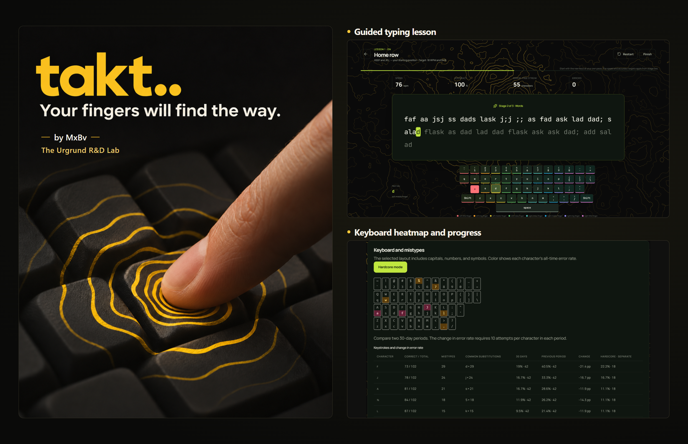

# takt..



**Your fingers will find the way.** takt.. is an offline touch-typing trainer for Windows. Learn by finger, practise the keys you miss, and see whether those mistakes get rarer in ordinary typing. Your local profile keeps the history so each session can build on the last.

The interface is available in English, Russian, Spanish, French, German and Portuguese. Choose a language in **Settings**. The typing courses and layout-switching drills use the English and Russian keyboard layouts.

## Guided course

- Start with a 45-second placement assessment, or work through 12 guided lessons in each layout. A lesson moves from finger drills to words and connected text. The virtual keyboard shows which finger to use, cues fade as you improve, and hints flag repeated wrong-layout typing or a Caps Lock mismatch.
- Finish the exercise, meet the pace target, and reach at least 94% accuracy to unlock the next lesson. Only words and connected text determine the score. Based on the result, the next pace target increases by 5%, 10%, or 15%. Retries keep the same target.

## Practice and training lab

- Use adaptive practice for weak keys or untimed precision practice to work on accuracy. Review commonly confused keys and slow letter transitions. Review intervals adjust to your results, up to 30 days.
- In **Hardcore**, up to five frequently missed symbols account for nine of every ten practice characters. Occasional home-row keys bring your fingers back to position. Hardcore has its own progress figures.
- Paste your own text or open a `.txt` file. Type a passage, repeat it, then type a different passage from the same text. The first attempt on the new passage shows how much of the improvement carries over.
- Practise switching between the English and Russian keyboard layouts in a separate 12-switch drill. Take a 45-second weekly benchmark for each layout to compare performance on a consistent task.
- Play **Orbit** and **Sprint 60** to vary your practice. Earn 12 achievements covering streaks, accuracy, pace, practice time, consistency, and course or game milestones.

## Progress and settings

- Filter your progress by 7 days, 30 days, or all time. See speed and accuracy charts for completed lessons, active practice time, recent sessions, slow keys, and an estimated trend once enough days have been sampled.
- The keyboard heatmap covers letters, numbers, punctuation, and shifted characters. Each row shows attempts, mistypes, and the characters you tend to press instead.
- Compare two consecutive 30-day periods. The table shows sample sizes and keeps ordinary practice and Hardcore results separate. A symbol needs at least 10 attempts in each window to show a change in error rate.
- Set your profile name, interface language, typing layout, lesson length, key sounds, keyboard guidance, and theme. Choose Dark or Topological Waves, which uses **Topological Echo**, the signature visual scheme of Navigational Cybernetics. Reset training history and keep your name and settings.

## Run locally

Use Node.js 24 for development.

```bash
npm ci
npm run dev:electron
```

Run `npm run dev` for the browser preview, which stores the profile in localStorage.

```bash
npm test
npm run build
npx playwright install chromium
npm run test:e2e
```

## Windows installers

Open the [latest release](https://github.com/petronushowcore-mx/takt/releases/latest) and choose the installer for your PC. Windows shows the system type under **Settings → System → About**.

- **Windows x64** for Intel and AMD PCs. Choose the file ending in `-x64.exe`.
- **Windows ARM64** for ARM-based PCs. Choose the file ending in `-arm64.exe`.

To build the installers from source, run the corresponding command.

```bash
npm run dist:x64
npm run dist:arm64
```

The installers are written to `packages/` as `takt-Setup-<version>-<architecture>.exe`. They are unsigned, so Windows SmartScreen may display a warning.

## Your data

The desktop app keeps its profile in `%APPDATA%\klavish\profile.json` and writes session events to `logs/sessions-YYYY-MM-DD.jsonl`. Progress reset clears the training history and journal while keeping your profile name and settings.

The Progress screen offers a full JSON export, a CSV export, and a separate AI summary in the versioned `takt.progress.v1` format. The summary includes a pseudonymous profile ID, the dates compared, totals by exercise mode, and per-symbol results for both layouts. It contains aggregate metrics and in-app miss counts. Exercise text and individual keystroke sequences are excluded. Your own passages stay out of the saved training history.

The standalone analyzer accepts a journal directory or a full JSON export.

```powershell
node tools/analyze-progress.mjs "$env:APPDATA\klavish\logs" --out analysis --lang en
node tools/analyze-progress.mjs takt-export.json --out analysis --days 90 --lang en
```

See the [journal and progress-report schemas](docs/log-schema.md) for field definitions. The app runs offline after installation and stores training results locally.

## Planned platform integration

We plan to connect takt.. to the platform’s main application so typing progress can contribute to a single personal report alongside activity from other tools. This release already provides the standalone local training history and an exportable summary.

## License

The project is available under the [MIT License](LICENSE). See [Credits](CREDITS.md) for third-party components and licenses.
